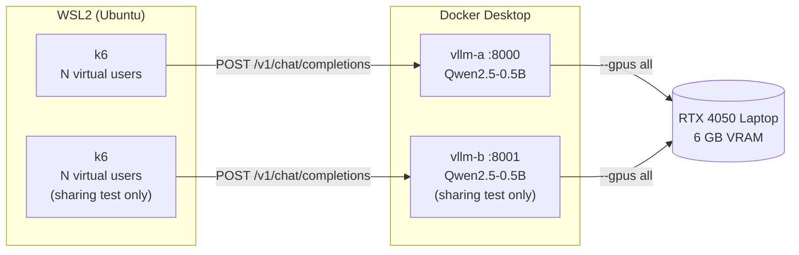

# LLM serving on one GPU: batching vs sharing, measured

How efficiently does an LLM server use a GPU, and what happens when two servers share one? This lab serves a small model with [vLLM](https://github.com/vllm-project/vllm), load-tests it with [k6](https://k6.io), and measures throughput and tail latency in two experiments:

1. **Batching:** one vLLM server, 1 to 64 requests in flight.
2. **Sharing:** two vLLM servers time-slicing one GPU vs one server, under the same total load.

Stack: vLLM v0.31.0, Docker (WSL2) with the NVIDIA Container Toolkit, k6 v2.2.0. Hardware: NVIDIA RTX 4050 Laptop GPU (6 GB).

This is a learning project, not a production system. Every number here comes from a real run on the hardware above; raw k6 outputs are in [loadtest/results/](loadtest/results/).

## Key findings

- **Batching is the main efficiency lever.** Going from 1 to 16 requests in flight raised throughput ~15× (129 → 1,916 tokens/s) while p95 latency stayed at ~1.1 s. At 64 requests, throughput was ~36× (4,716 tokens/s) at 1.8 s p95.
- **Time-slicing one GPU between two copies of a model wasted about half of it.** Under the same total load, two servers produced 47–53% fewer tokens/s than one server and roughly doubled p95 latency.
- **For one model, scale the batch before adding copies.** Sharing a GPU makes sense for different, low-traffic models, and then memory limits need to be enforced.

## Setup



- **Load:** each k6 virtual user (VU) sends one chat request, waits for the full answer, then sends the next, for 60 s ([loadtest/sweep.js](loadtest/sweep.js)). So VUs = requests in flight.
- **Same work per request:** every request generates exactly 128 tokens (`max_tokens: 128`, `ignore_eos: true`), and a random number at the start of each user message keeps the prompts different. Prompts are short (~40 tokens), so nearly all the work is generating tokens.
- **Metrics:** throughput = generated tokens per second summed over all users. Latency = full request time (k6 `http_req_duration`), from sending the request to receiving the last token.

## Results

### 1. Batching: throughput vs latency, one vLLM server

Server: `--gpu-memory-utilization 0.7`, `--max-model-len 4096` (KV cache 2.46 GiB, ~215k tokens).

| VUs (requests in flight) | Throughput (tokens/s) | Requests in 60 s | p50 latency | p95 latency | Failed |
|---:|---:|---:|---:|---:|---:|
| 1  |   129 |   61 | 0.98 s | 1.06 s | 0 |
| 2  |   257 |  122 | 0.99 s | 1.03 s | 0 |
| 4  |   495 |  236 | 1.03 s | 1.05 s | 0 |
| 8  |   976 |  464 | 1.05 s | 1.08 s | 0 |
| 16 | 1,916 |  912 | 1.07 s | 1.09 s | 0 |
| 32 | 3,157 | 1,505 | 1.27 s | 1.32 s | 0 |
| 64 | 4,716 | 2,240 | 1.73 s | 1.79 s | 0 |

What it shows:
- **Up to 16 users, batching is almost free.** Throughput grows ~15× while p95 latency rises by only 0.03 s. vLLM runs all in-flight requests in the same GPU step, and each step costs about the same whether it serves 1 request or 16.
- **Past 16 users, latency starts to pay.** At 64 users throughput is ~36× the single-user value, but each request takes 1.73 s instead of 0.98 s (~13.5 ms per token instead of ~7.7 ms). Each user gets slower tokens; the GPU produces many more in total.
- **The operating point depends on the latency target.** If the target is p95 < 1.1 s, this server should run at about 16 concurrent requests. If the target is p95 < 2 s, 64 requests give ~2.5× more throughput.

### 2. Sharing: two vLLM servers on one GPU vs one

Every server gets `--gpu-memory-utilization 0.35` (~2.1 GB, KV cache 31,424 tokens), so the only difference between runs is sharing. Two servers run as two containers on the same GPU, and two k6 runs load them at the same time. With no sharing tool installed, the GPU time-slices between the two processes: it runs one, then switches to the other.

Same total load, one server vs two:

| Total users | Setup | Total throughput (tokens/s) | p50 latency | p95 latency | p99 latency | Failed |
|---:|---|---:|---:|---:|---:|---:|
| 32 | 1 server, 32 users | 3,149 | 1.30 s | 1.34 s | 1.43 s | 0 |
| 32 | 2 servers, 16 users each | 1,471 (751 + 720) | 2.69 s | 2.87 s | 3.26 s | 0 |
| 64 | 1 server, 64 users | 4,728 | 1.68 s | 1.86 s | 1.90 s | 0 |
| 64 | 2 servers, 32 users each | 2,517 (1,261 + 1,256) | 3.27 s | 3.45 s | 3.47 s | 0 |

For two servers, latency is the worse of the two servers. Sanity check: the 0.35 single server matched the 0.7 sweep above within ~1% (16 users: 1,890 vs 1,916 tokens/s), so the smaller KV cache did not limit these runs.

What it shows:
- **Sharing cost about half the throughput.** With the same users, two servers produced 47–53% fewer tokens/s than one server and roughly doubled p95 latency.
- **Two servers together made less than one server serving only half the users.** 16 + 16 users on two servers gave 1,471 tokens/s; one server with 16 users gave 1,890 tokens/s.
- **Where the loss comes from (estimate, not profiled):** if switching between the two processes were free, each server would get half the GPU and the pair would match one server with 16 users (~1,890 tokens/s). That part, ~40% below one server with 32 users, is lost batching: the two servers cannot batch together. The remaining gap down to 1,471 tokens/s (~22% below that ideal) is switching overhead and idle gaps.
- **Takeaway:** time-slicing gives two workloads access to one GPU, but not more capacity. Sharing makes sense for different models with low traffic, and then memory limits must be enforced (for example with HAMi or MIG), because `--gpu-memory-utilization` is a setting each server follows, not a limit the GPU enforces.

## Reproduce

Requirements: an NVIDIA GPU visible to Docker (`docker run --rm --gpus all nvidia/cuda:12.4.1-base-ubuntu22.04 nvidia-smi` works) and k6.

```bash
# Server A (for the batching sweep, use --gpu-memory-utilization 0.7)
docker run -d --name vllm-a --gpus all -p 8000:8000 --ipc=host \
  -v hf-cache:/root/.cache/huggingface vllm/vllm-openai:v0.31.0 \
  Qwen/Qwen2.5-0.5B-Instruct --gpu-memory-utilization 0.35 --max-model-len 4096

# One load point: 16 VUs for 60 s
k6 run -e VUS=16 --summary-trend-stats "med,p(95),p(99)" \
  --summary-export loadtest/results/share-single-vus16.json loadtest/sweep.js

# Sharing test: start server B after A is healthy (curl localhost:8000/health),
# then load both at the same time
docker run -d --name vllm-b --gpus all -p 8001:8000 --ipc=host \
  -v hf-cache:/root/.cache/huggingface vllm/vllm-openai:v0.31.0 \
  Qwen/Qwen2.5-0.5B-Instruct --gpu-memory-utilization 0.35 --max-model-len 4096
k6 run -e VUS=16 -e URL=http://localhost:8000/v1/chat/completions \
  --summary-export loadtest/results/share-pair-a-vus16.json loadtest/sweep.js &
k6 run -e VUS=16 -e URL=http://localhost:8001/v1/chat/completions \
  --summary-export loadtest/results/share-pair-b-vus16.json loadtest/sweep.js &
wait

docker stop vllm-a vllm-b
```

## Watch a run live (Prometheus + Grafana)

vLLM exposes its internal state at `/metrics`: requests running and waiting, KV cache usage, time to first token and time between tokens. [monitoring/](monitoring/) runs Prometheus, which scrapes that page every 5 s, and Grafana, which is already connected to it.

```bash
docker compose -f monitoring/docker-compose.yml up -d   # vLLM must be running on :8000
loadtest/run-sweep.sh knee 64 128 256                   # load it while watching the graphs
python loadtest/summarize.py loadtest/results/knee-vus*.json
docker compose -f monitoring/docker-compose.yml down    # recorded data stays in a Docker volume
```

- Prometheus: http://localhost:9090/targets (the `vllm` target should be UP)
- Grafana: http://localhost:3000 (no login; both ports are bound to localhost only)

## Limitations

- **One small model on one laptop GPU.** Absolute numbers are specific to a 0.5B model on an RTX 4050 Laptop under WSL2. The direction of the results (batching helps until latency bends; time-slicing copies of one model loses capacity) is expected to hold elsewhere. The size of the switching overhead may differ on a datacenter GPU under native Linux and with larger models, where each GPU step is longer.
- **Short, fixed requests.** Every request has a short prompt and exactly 128 output tokens. Real traffic with long prompts and varied lengths fills the KV cache much faster.
- **Some prompt caching remained.** Qwen's chat template puts the same default system prompt in front of every user message, so vLLM's prefix cache still matched that shared part (the vLLM log showed a ~29% prefix-cache hit rate during the batching sweep). With ~40-token prompts and 128-token answers, this barely changes the results. It also matches real chat traffic, where requests share a system prompt.
- **Not profiled.** The split of the sharing loss into lost batching and switching overhead is an estimate from the numbers above, not from a GPU profiler.

## Possible next steps

- Prometheus and Grafana on vLLM's `/metrics` during the runs, to show KV cache usage and queued requests behind the latency curve.
- Enforced sharing (HAMi, or MIG on a GPU that supports it) compared with plain time-slicing.
- The same experiments on a datacenter GPU under native Linux, deployed on Kubernetes.
